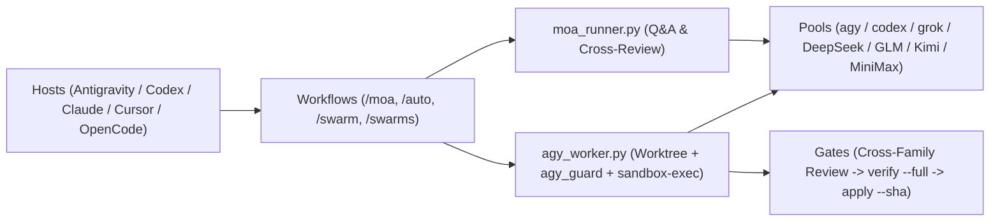

# Crucible

Cross-platform multi-agent orchestration, sandboxed coding workers, and cross-family verification for **Antigravity (`agy`)**, **Codex**, **Claude Code**, **Cursor**, and **OpenCode** *(formerly MoA — `/moa`, `/auto`, `/swarm`, and `/swarms` commands remain unchanged)*.

- **One source, five hosts**: Shared runners, configs, and workflow specs live in `skills/`, `config/`, and `shared/`; `install.sh` symlinks lightweight platform entrypoints into each host.
- **Subscription-first routing**: Prioritizes zero-marginal-API-cost subscription pools (`agy`, ChatGPT `codex`, OpenCode `grok` OAuth) with tiered model assignment and 3-tier automatic failover.
- **Sandboxed execution & patch gates**: Every delegated code edit runs inside a disposable shallow worktree with a default-deny guard (`agy_guard.py`), network-disabled macOS `sandbox-exec`, cross-family diff review, full sandbox verification, and SHA-locked apply.
- **Evidence-based synthesis**: Multi-model Q&A collects independent answers without counting repeated claims as extra evidence, preserving unresolved disagreements.



## Workflows

| Workflow | Purpose | How it runs |
|---|---|---|
| `/moa` | Multi-model Q&A and trade-off analysis | Collects `agy` (`Orchestrator (Neon)`), `codex`, `grok`, and configured API workers (`deepseek`/`glm`/`kimi`/`minimax`), then synthesizes in the current host session |
| `/auto` | Delegated single-module coding | Dispatches an isolated `agy` sandbox worker (or native Claude Code CLI / Claude cloud bridge), runs cross-family review, `verify --full`, and `apply --sha` |
| `/swarm` / `/swarms` | Parallel multi-file orchestration | Splits work into disjoint slices across sandboxed workers with cross-family verification and quota failover *(Antigravity reserves `/swarm` for its built-in Native Swarm UI and exposes `/swarms`)* |

## Quick Start

### Prerequisites
- **Python 3** and **Git**
- **macOS `sandbox-exec`** for sandboxed coding worker execution and verification
- At least one signed-in subscription CLI (`agy`, `codex`, OpenCode `xai` OAuth) or API key configured in `skills/moa/.env`

### 1. Install platform entrypoints

```bash
./install.sh --dry-run
./install.sh                    # all platforms (codex, claude, gemini, opencode, cursor)
# Or install selectively: ./install.sh --platform gemini
```

### 2. Inspect config and check provider health

```bash
python3 skills/moa/moa_runner.py --doctor
python3 skills/auto/agy_worker.py models --live
python3 skills/moa/moa_runner.py --platform cursor --show-config
```

### 3. Run in chat or from the CLI

- **In chat**: invoke `/moa <question>`, `/auto <module task>`, or `/swarms <multi-file goal>` (Antigravity, Cursor, and OpenCode also auto-triage prompts via installed rules/agents without typing a prefix).
- **From CLI**:

```bash
# Zero-marginal-API-cost second opinion via Google AI Ultra (Orchestrator Neon)
python3 skills/moa/moa_runner.py --platform cursor --models agy -- 'Review this API boundary'

# Compare multiple model families (raw mode for host synthesis)
python3 skills/moa/moa_runner.py --platform gemini --models agy,codex,deepseek -- 'Compare locking strategies'
```

Use `--platform headless` with `moa_runner.py` when no platform entrypoint applies and an explicit API aggregator step is wanted.

## Tiered Model Routing & Providers

Role defaults, active `agy` families, and failover routes are centralized in [config/headless.json](config/headless.json); platform profiles (`codex.json`, `claude.json`, `gemini.json`, `opencode.json`, `cursor.json`) inherit from it.

### Tiered `agy` Routing Defaults

| Tier / Role | Default Model | Notes / Fallback |
|---|---|---|
| `filler` (boilerplate, comments, mock data) | `gemini-4-argon-low` | Reserves Neon/Carbon/Hydrogen quota; fallback `gemini-4-argon-medium` |
| `L1` (bounded fast edits) | `gemini-4-carbon-high` | Fallback `gemini-4-argon-high` |
| `L2` (standard feature / slice coding) | `gemini-4-neon-high` | Fallback `gemini-4-carbon-high` or `claude-sonnet-5-5-high` |
| `L3` (architecture / deep diagnosis) | `gemini-pro-orchestrator-neon` / `gemini-4-neon-xhigh` | Fallback `gemini-pro-orchestrator` |
| `/moa` `agy` slot & Claude-author review | `gemini-pro-orchestrator-neon` (`Orchestrator (Neon)`) | `agy` runs read-only via `--mode plan` |
| Gemini-author cross-family review | `claude-opus-5-5-high` / `claude-sonnet-5-5-high` | Falls back across `gpt-oss-120b-medium`, `codex`, `grok`, or APIs |

Run `python3 skills/auto/agy_worker.py models --json` to inspect all 11 families / 27 canonical model IDs without calling any model.

### Supported Providers

| Provider | Default Model | Auth / Billing | Effort & Variant Selectors |
|---|---|---|---|
| `agy` | `Orchestrator (Neon)` (`gemini-pro-orchestrator-neon`) | Local `agy` CLI (Google AI Ultra subscription) | `agy/<model-id>` or UI display names |
| `codex` | `GPT-6-Luna (High)` (`gpt-6-luna-high`) | ChatGPT/Codex CLI (`ChatGPT.app` bundled CLI preferred) or `OPENAI_API_KEY` | `codex-max` / `gpt-6-luna-max`, `low`–`xhigh` |
| `grok` | `Grok-4.7` (`grok-4.7`) | Signed-in OpenCode `xai` OAuth only | — |
| `deepseek` | `DeepSeek-V4-Pro` | `DEEPSEEK_API_KEY` (prepaid API) | `deepseek-v4.1` / `deepseek-flash` (`DeepSeek-V4.1-Flash`), `-low`/`-high`/`-max` |
| `glm` | `GLM-5.3` | `ZHIPUAI_API_KEY` (prepaid API) | — |
| `kimi` | `Kimi-K3.1-Pro` | `MOONSHOT_API_KEY` or `KIMI_API_KEY` (prepaid API) | `kimi-highspeed`, `-low`/`-high`/`-max` |
| `minimax` | `MiniMax-M3` | `MINIMAX_API_KEY` (prepaid API) | — |

### 3-Tier Automatic Failover
1. **Tier 1 (`agy` dual quota pools)**: Switches between **Gemini 4 / Orchestrator** and **Claude 5.5 / `gpt-oss-120b-medium`** on `429` or `quota_exhausted`, preserving partial `diff.patch` files.
2. **Tier 2 (`agy` exhausted or unsubscribed)**: `review --executor auto` fails over to ChatGPT `codex` (`gpt-6-luna-high`) and OpenCode `grok` at zero marginal API cost before reaching API fallbacks; coding falls back to host or scoped subagents.
3. **Tier 3 (prepaid API errors/exhaustion)**: `moa_runner.py` (`--review` / `aggregate`) and `agy_worker.py review --executor api` fail over across remaining configured providers (`deepseek` → `deepseek-flash` → `glm` → `kimi` → `minimax`).

## Security Sandbox, Patch Gates & Evidence Rules

Delegated coding follows [shared/auto-workflow.md](shared/auto-workflow.md) through five strict gates:
1. **Isolated worktree**: Each `agy_worker.py run` clones a disposable shallow worktree in `$TMPDIR`, keeping uncommitted host edits untouched.
2. **Default-deny guard**: `agy_guard.py` restricts tools/paths and protects control directories (`.git`, `.claude`, `.codex`, `.opencode`, `.cursor`, `.gemini`, `.agents`, `.github`, `.vscode`, `.idea`, `venv`/`.venv`, `node_modules`) case-insensitively at any depth.
3. **Network-disabled sandbox**: Commands execute under macOS `sandbox-exec` (`sandbox.sb`) with network disabled and bounded same-session transport recovery (`--network-retries 0..2`, default `1`).
4. **Cross-family review**: Read-only review inspects the brief, `diff.patch`, and `REVIEW_FLAGS` before any patch is trusted.
5. **Verified SHA apply**: `apply --sha` requires a matching reviewed patch hash, clean target paths, and a passing `verify --full` run against current `HEAD`.

Run records are stored in `skills/moa/runs/` and `skills/auto/runs/` (`runs.jsonl`), all ignored by Git. For Q&A evidence rules and the 4-stage `--cross-review` protocol, see [shared/moa-workflow.md](shared/moa-workflow.md#evidence-based-collaboration) and [shared/evidence-review-proposal.md](shared/evidence-review-proposal.md).

## Platform Install Targets

| Platform | Installed Symlinks | Notes |
|---|---|---|
| **Antigravity / Gemini** (`--platform gemini` / `agy`) | `~/.gemini/config/skills/{moa,auto,swarms}` + `~/.gemini/config/rules/swarm-coordinator.md` | `always_on` triage rule; `/swarm` stays free for Native Swarm UI; guard hook registered in `~/.gemini/config/hooks.json` |
| **Codex** | `~/.agents/skills/{moa,auto,swarm}` | Explicit `/swarm` coding tasks prefer guarded `agy` (`config/codex.json`); parallel research uses native subagents |
| **Claude Code** | `~/.claude/skills/{moa,auto}` | Independent links (replaces legacy Claude→Codex links) |
| **Cursor** | `~/.cursor/skills/{moa,auto,swarm}`, `~/.cursor/agents/swarm-coordinator.md`, `~/.cursor/rules/swarm-coordinator.mdc` | `alwaysApply: true` rule; skills remain auto-invocable |
| **OpenCode** | `~/.config/opencode/skills/{moa,auto,swarm}` + `~/.config/opencode/agents/swarm.md` | Set `"default_agent": "swarm"` in `opencode.jsonc` for prefix-free triage |

<details>
<summary>Installer migrations, OpenCode/Cursor setup, and Claude Local/Cloud bridges</summary>

- **Backups & `.env` handling**: `install.sh` backs up conflicts under `~/.local/share/moa-install-backups/`, preserves unrelated Gemini hooks, and keeps API keys solely in `skills/moa/.env` (copying from an older checkout if present, else seeding from `skills/moa/.env.example`).
- **OpenCode host model**: Keep OpenCode's host on `zhipu/glm-5.3`, `deepseek/deepseek-v4-pro`, `minimax/MiniMax-M3`, `xai/grok-4.5`, or `opencode/*-free` rather than OpenCode's built-in `google/*` provider (which hits Google AI Studio Free Tier `limit: 0` instead of Google AI Ultra).
- **Cursor User Rules**: To enforce triage before project rules load, paste the short Coordinator rule into **Cursor Settings > Rules > User Rules**.
- **Native Claude Code CLI (`claude_local.py`)**: Uses first-party Claude Pro/Max allowance via a scoped MCP file/test broker ([shared/claude-local-workflow.md](shared/claude-local-workflow.md)) with local `verify --full` and `--sha` gates.
- **Claude Cloud Bridge (`claude_cloud.py`)**: Supports `prepare`, `observe-funding`, `launch` / `attach` / `send`, and sandbox-verified local patch import ([shared/cloud-workflow.md](shared/cloud-workflow.md)):
  ```bash
  python3 skills/auto/claude_cloud.py prepare --repo "$PWD" --brief '<brief.md>' --platform cursor
  python3 skills/auto/claude_cloud.py attach '<run-id>' --session '<Claude-cloud-session-URL>'
  python3 skills/auto/claude_cloud.py status '<run-id>'
  ```

</details>

## Repository Layout

```text
AGENTS.md / CLAUDE.md / GEMINI.md   platform-specific project entrypoints
platforms/codex/skills/             Codex moa, auto, and swarm skill entrypoints
platforms/claude/skills/            Claude moa and auto skill entrypoints
platforms/gemini/                   Antigravity / Gemini skills (`moa`, `auto`, `swarms`) & `always_on` rule (aliased by `platforms/agy/`)
platforms/opencode/                 OpenCode skills (`moa`, `auto`, `swarm`) & primary `swarm` agent
platforms/cursor/                   Cursor skills (`moa`, `auto`, `swarm`), subagent, & `alwaysApply` rule
shared/                             common project, evidence, sandbox, and bridge workflows
config/                             provider/model catalog (`headless.json`) and per-host profiles
docs/                               supplementary prompt templates (e.g. `chatgpt-moa-swarm-prompt.md`)
skills/moa/                         shared MoA runner, evidence cross-review, and offline tests
skills/auto/                        agy/Claude executors, guard, sandbox profile, recovery, and offline tests
tests/                              installer and platform package verification suites
```

Edit sources in `skills/`, `shared/`, or `config/`; platform folders contain symlinks, not duplicated code.

## Offline Verification

```bash
python3 skills/moa/test_runner.py
python3 skills/moa/test_evidence_review.py
python3 skills/auto/test_guard.py
python3 skills/auto/test_worker.py
python3 skills/auto/test_cloud.py
python3 skills/auto/test_local.py
python3 skills/auto/test_recovery.py
python3 tests/test_install.py
python3 tests/test_platforms.py
```

All suites use mocked providers/CLIs, temporary git repos, and isolated temporary homes with zero paid model calls (sandbox checks require macOS `sandbox-exec`).
